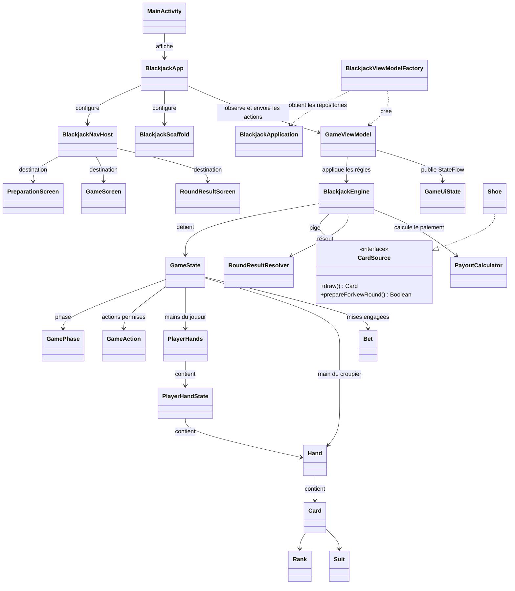
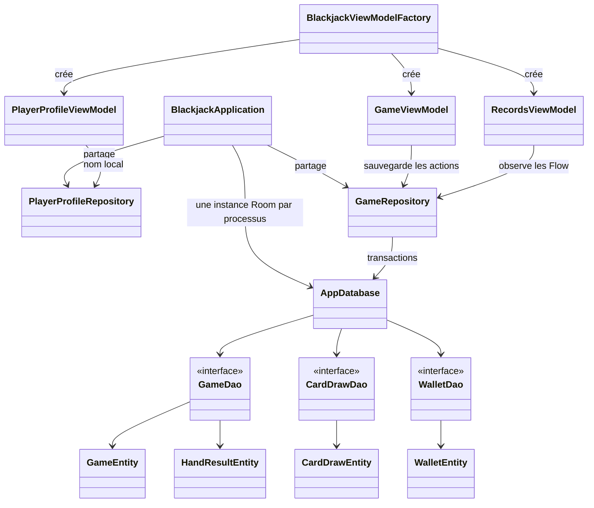
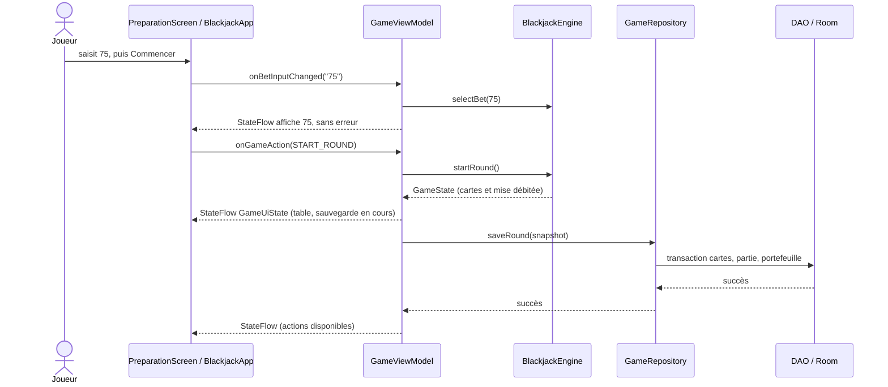

# Architecture réelle du Blackjack

Les noms ci-dessous correspondent aux classes et fichiers du projet final. `BlackjackViewModelFactory` est une valeur Kotlin de type factory, pas une classe déclarée; son rectangle représente ce rôle. Les flèches « utilise » désignent une dépendance de code, pas un héritage.

`MainActivity` installe Compose. `BlackjackApp` conserve les ViewModels partagés, collecte leurs `StateFlow` selon le cycle de vie et relie les destinations. Les écrans affichent `GameUiState` et transmettent les clics; ils ne décident pas qui gagne. `BlackjackScaffold` contient la barre supérieure, les onglets et le bouton Piger.

`GameViewModel` transforme la saisie en mise validée, appelle `BlackjackEngine`, puis demande au `GameRepository` d'enregistrer un instantané. `GameState` est la vérité des règles en mémoire; `GameUiState` est sa projection prête à afficher. Le moteur utilise `CardSource`, implémenté normalement par `Shoe`, et ne dépend ni de Compose ni de Room.

`GameRepository` est la frontière des données. Une action sauvegardée met à jour les cartes, la manche et le solde dans une transaction Room. Les DAO décrivent les requêtes SQLite. `CardDrawDao` calcule les statistiques des cartes réellement observées; Room émet un `Flow` après les changements. `RecordsViewModel` combine ces `Flow` avec `stateIn`, et Compose affiche le nouvel état.

La rotation recrée les Composables mais garde le ViewModel de la même Activity. Après une mort du processus, Room restitue le solde, la mise, l'historique et les cartes observées; la manche en cours est marquée interrompue et ses mises sont remboursées une seule fois. Le nom local est stocké séparément dans `PlayerProfileRepository` via SharedPreferences.
